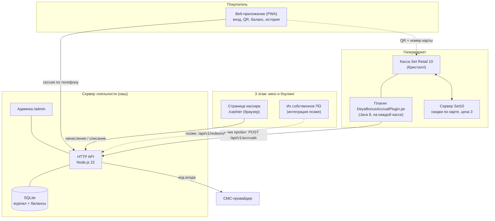
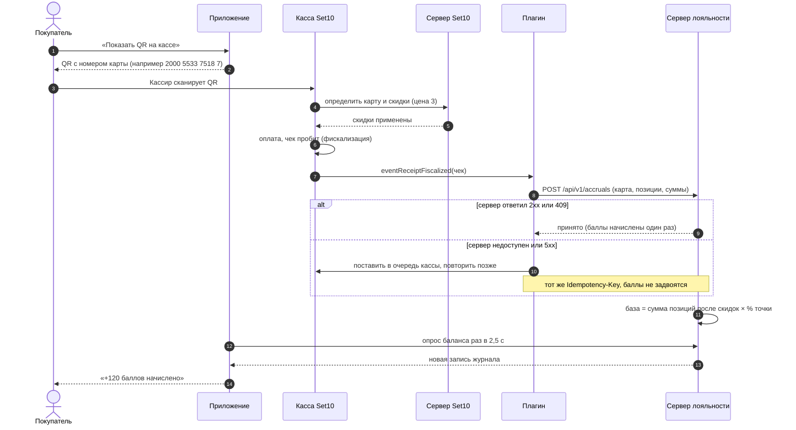
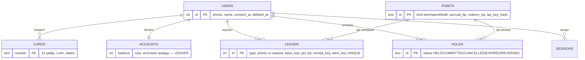
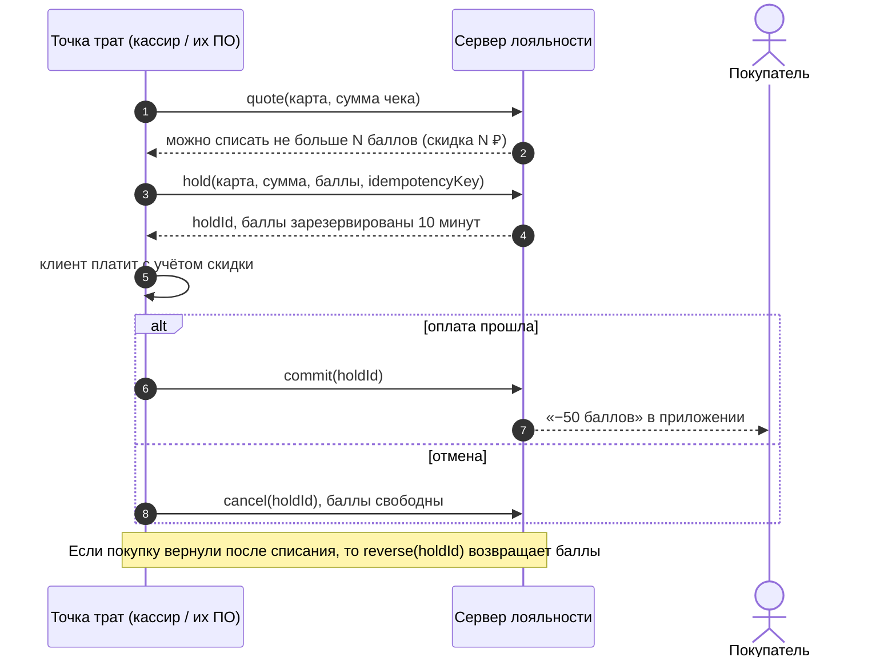

# Архитектура системы лояльности ТРЦ «Дея»

Документ описывает итоговую систему, каждый компонент, логику работы и текущий статус: что готово и проверено, что готово частично, что ещё предстоит.

> **Как читать статусы.**
> ✅ **готово и проверено** — написано и прогнано автотестами/браузером в этой среде;
> 🟡 **готово, но не проверено в боевых условиях** — код есть, но нужна проверка на реальном оборудовании/сервисе;
> ⚪ **заложено в архитектуре** — места под функцию подготовлены, самой функции нет;
> ❌ **не начато**.

## 1. Общая схема

**Главная идея.** Касса ничего не считает: она только сообщает серверу «по карте N пробит чек на такие-то позиции». Сервер сам считает баллы по процентам, которые админ меняет в админке, без перепрошивки касс. Покупатель видит результат в приложении через пару секунд.

## 2. Как проходит покупка в гипермаркете

## 3. Компоненты

### 3.1 Плагин для касс Set Retail 10 (`set10-bonus-plugin/`)

| | |
|---|---|
| Назначение | После пробития чека отправить на наш сервер номер карты и позиции чека |
| Технология | Java 8, интерфейс `LoyaltyPlugin` из SDK Set10, без внешних библиотек |
| Что делает | Определяет карту покупателя; формирует запрос; отправляет за короткий таймаут; при сбое ставит чек в очередь кассы и повторяет; для возвратов шлёт ссылку на исходный чек |
| Чего НЕ делает | Не считает баллы, не меняет цены и скидки, не блокирует кассу при сбоях сервера |
| Надёжность | Ключ идемпотентности `fd:<ФН>:<ФД>`; предохранитель (3 сбоя подряд — пауза 30 с); сетевые сбои не расходуют лимит попыток |
| Статус | ✅ код и 54 проверки; ✅ против настоящего сервера (4 сценария, см. TESTING.md); 🟡 **на настоящей кассе Set10 ещё не запускался** |

Подробности: `set10-bonus-plugin/README.md`, установка: `docs/INTEGRATION.md`.

### 3.2 Сервер лояльности (`server/`)

Один процесс Node.js 22 без внешних библиотек (в среде разработки npm был заблокирован, поэтому выбраны только встроенные модули Node: `node:http`, `node:crypto`, `node:sqlite`, `node:test`). Модульный монолит: каждый файл отвечает за одно.

| Файл | Ответственность |
|---|---|
| `src/loyalty.js` | **Ядро**: расчёт баллов, начисление, возвраты, резерв/списание, журнал, сверка |
| `src/auth.js` | Вход по коду из СМС, сессии |
| `src/app.js` | Все HTTP-маршруты: клиент, касса/плагин, админ |
| `src/http.js` | Мини-роутер, JSON, раздача веб-приложения, заголовки безопасности, лимит размера и частоты запросов |
| `src/db.js`, `schema.sql` | База данных, транзакции (`BEGIN IMMEDIATE`, вложенные через SAVEPOINT) |
| `src/sms.js` | Отправка СМС: заглушка `console` (разработка) и `http` (любой провайдер с GET-запросом) |
| `src/config.js` | Настройки из переменных окружения, защита от запуска в бою без секретов |

#### Модель данных

Главные правила:

* **Журнал только добавляется.** Баланс = сумма записей журнала; кэш в `accounts` проверяется сверкой (`scripts/reconcile.mjs`, блок «Расхождений журнала» в админке).
* **Деньги в копейках, баллы целые.** Никаких дробных чисел при расчётах.
* **Идемпотентность.** Повтор запроса с тем же ключом не меняет баланс: начисление отвечает `409` с прежним результатом.
* **Проценты хранятся в сотых долях процента** (`500` = 5 %), меняются в админке без перезапуска; уже совершённые операции не пересчитываются, а возврат считается по ставке исходного начисления.

#### Правила расчёта

| Что | Правило | Где менять |
|---|---|---|
| База начисления | сумма **строк чека после скидок** `Σ line.sum` по позициям, где `accrueAllowed ≠ false`; если строк нет — итог чека | код `accrualBase` |
| Баллы за чек | `база × % точки ÷ 100 ÷ (₽ за балл)`, округление до ближайшего (half-up) или вниз | админка: процент точки, «1 балл = N ₽», округление |
| Возврат | `−(сумма возвращённых позиций × ставка исходного начисления)`, не больше начисленного по этому чеку, не больше доступного баланса (недостача пишется в журнал) | — |
| Макс. оплата баллами | `min(доступные баллы, чек × % списания ÷ (₽ за балл))` | админка: «макс. оплата баллами, % чека» |
| Резерв баллов | действует 10 минут (`HOLD_TTL_SEC`), потом освобождается сам | переменная окружения |
| Срок жизни баллов | **не сгорают** | — |

### 3.3 Веб-приложение покупателя (`web/`)

PWA без фреймворков: чистый JavaScript-модули, один CSS. Устанавливается на экран телефона («Добавить на главный экран»), открывается из браузера без магазина приложений.

| Экран | Что делает | Статус |
|---|---|---|
| Вход | Номер телефона → код из СМС, 4 цифры, автоподстановка кода, повторная отправка через 60 с | ✅ (СМС: ⚪ нужен провайдер) |
| Главная | Баланс, процент начисления, «Показать QR на кассе», «Как можно тратить баллы?», последние операции | ✅ |
| QR | Крупный QR с номером карты, держит экран включённым, **сам показывает «Начисление прошло»**, когда сервер получил чек | ✅ |
| Как тратить | Горизонтальная карусель: кино и боулинг, «Скидка на билеты X %» / «Скидка на бронь до Y %» (числа берутся из админки; пока 0 — «Скоро») | ✅ |
| История | По дням, «За октябрь начислено», подгрузка | ✅ |
| Профиль | Имя, номер карты, «Как работают баллы», выйти, удалить аккаунт | ✅ |
| Пуш-уведомления | Были на макете (переключатель), **не реализованы** | ❌ см. IDEAS |

Страницы для персонала (тот же сервер, отдельные адреса):

* `/cashier` — касса точки: ввод ключа точки; поиск клиента по номеру карты, телефону или сканированием QR камерой (там, где браузер поддерживает `BarcodeDetector`); начисление и списание. ✅ (камера: 🟡 проверить на ваших устройствах)
* `/admin` — проценты по точкам, ключи точек, правила округления, поиск клиентов и ручная корректировка, выгрузка карт в CSV, журнал действий. ✅

### 3.4 Режимы QR

QR сейчас кодирует **номер карты** (режим `static`), потому что Set10 понимает только номер своей карты. Смена режима изолирована в одной функции `qrPayload()` (`server/src/app.js`). Режим с одноразовым обновляющимся кодом ⚪ заложен, но не включён: он несовместим со сканированием на кассе Set10.

## 4. Точки и списание (3 этаж и другие)

* **Сервер:** все операции написаны и проверены (в том числе параллельная нагрузка через два процесса) — ✅.
* **Страница кассира** умеет списывать — ✅, подходит, если у кино/боулинга кассир сам нажимает кнопки.
* **Автоматическая связка с ПО кино и боулинга** — ❌ не начата: зависит от того, что это за ПО (открытый вопрос).
* **Бронирование** боулинга и кино — ⚪ не реализуется (по вашему решению), но место готово: новые разделы приложения — это новые экраны в `web/app.js` (маршрут + функция) и новые маршруты в `server/src/app.js`; баллы за бронь пойдут через те же `quote/hold/commit`.

## 5. Безопасность и персональные данные

| Мера | Статус |
|---|---|
| Ключи точек хранятся только в виде хэша (sha256), показываются один раз, выпускаются заново в админке | ✅ |
| Коды из СМС хранятся хэшем (HMAC с `APP_SECRET`), живут 5 минут, 5 попыток, не чаще раза в минуту и 5 в час на номер | ✅ |
| В боевом режиме сервер не стартует без `ADMIN_TOKEN` и без реального СМС-провайдера | ✅ |
| Защита от выхода за пределы папки, лимит размера запроса 256 КБ, заголовки CSP/nosniff/DENY, ограничение частоты запросов | ✅ |
| Весь текст на клиенте вставляется без HTML (имя `<b>Анна</b>` отображается как текст) | ✅ |
| Удаление аккаунта: телефон и имя стираются, карта закрывается; обезличенный журнал баллов остаётся | ✅ (юридически: см. ниже) |
| HTTPS | 🟡 автоматически через Caddy в `docker-compose.yml`, в этой среде Docker не запускался |
| Согласие на обработку данных (152-ФЗ) | 🟡 момент согласия сохраняется, текст — заглушка со страницы входа; **политику обработки данных и юридическую проверку должен сделать юрист**. Телефоны граждан РФ должны храниться на серверах в РФ |

## 6. Сводка: что готово и что впереди

| # | Блок | Статус | Комментарий |
|---|---|---|---|
| 1 | Макеты | ✅ | `mockups.html` |
| 2 | Плагин Set10 | ✅ код / 🟡 касса | не запускался на настоящем Set10 |
| 3 | Сервер: начисление, возвраты, журнал, идемпотентность | ✅ | 44 автотеста + 2 процесса под нагрузкой |
| 4 | Сервер: списание (резерв, подтверждение, отмена, возврат) | ✅ | не подключено к ПО кино/боулинга |
| 5 | Вход по коду из СМС | ✅ код / ⚪ провайдер | нужен выбор провайдера |
| 6 | Веб-приложение покупателя | ✅ | проверено в Chromium |
| 7 | Страница кассира, админка | ✅ | проверено в Chromium |
| 8 | Docker, HTTPS, резервные копии | 🟡 | файлы готовы, `docker compose config` проходит, образ не собирался (нет демона) |
| 9 | Нативное приложение Android/iOS | ❌ | PWA закрывает старт; Play Market/App Store — позже (оболочка поверх этого же API) |
| 10 | Пуш-уведомления | ❌ | |
| 11 | Загрузка карт приложения в Set10 | ❌ | выгрузка CSV готова; способ загрузки зависит от версии Set10 |
| 12 | Связка с ПО кино/боулинга | ❌ | ждём информацию о ПО |
| 13 | Бронирование | ⚪ | не реализуется сейчас |
| 14 | Юридический блок (политика, согласие) | ❌ | |

## 7. Допущения, которые я сделал (проверьте, это ваши решения)

1. **База начисления — сумма строк после скидок** (скидки Set10 «цена 3» уже учтены), а не итог чека. Если нужно исключить оплату бонусами или категории (алкоголь, табак), нужно либо проставить в Set10 флаг «начислять бонусы» на этих товарах (плагин его читает), либо уточнить правило.
2. **Возврат** уменьшает баллы по ставке исходной покупки; если клиент баллы уже потратил, баланс уходит в 0 (не в минус), недостача фиксируется в журнале.
3. **1 балл = 1 ₽** до тех пор, пока вы не зададите иное.
4. **Один клиент — одна карта**; карта выпускается автоматически при регистрации.
5. **Неизвестная карта** от кассы получает отказ `422`, плагин такой чек больше не повторяет.
6. База данных — **SQLite** (один файл). Для одного ТРЦ этого с запасом: проверено 300 параллельных запросов через 2 процесса. При росте на порядки или при втором сервере нужен переход на PostgreSQL: слой работы с БД изолирован в `db.js` и `loyalty.js`, SQL простой.
